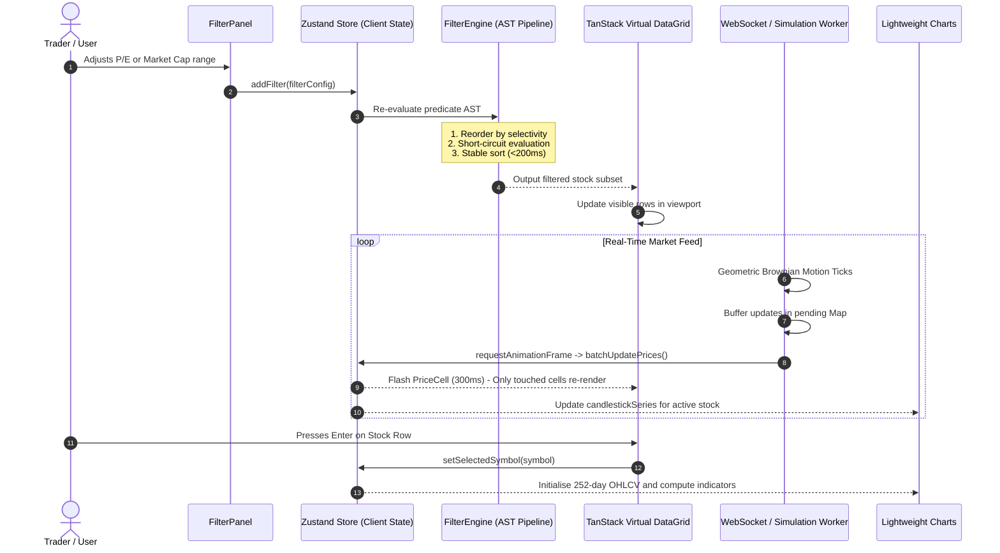

# System Architecture & Technical Design Document

## 1. Executive Architecture Summary

EquityPulse is a high-frequency, institutional-grade Indian equity screener designed to evaluate and navigate a live universe of **5,000+ instruments** with sub-200ms filter execution, 60 FPS virtualized scrolling, and real-time streaming price updates.

```
+-------------------------------------------------------------------------------+
|                             Next.js 14 App Shell                              |
+-------------------------------------------------------------------------------+
|  Header Bar (Global Search, WS Status, Dark Mode, CSV Export, Heatmap Toggle) |
+-----------------------+-------------------------------------------------------+
|  Filter Sidebar (320px)|  Main Workspace Area                                  |
|  - 30+ Criteria       |  +---------------------------+-----------------------+|
|  - Predicate AST      |  | TanStack Virtual DataGrid | Lightweight Charts    ||
|  - Saved Presets      |  | - 5,000+ Row Virtualizer  | - Candlestick Series  ||
|  - Live Match Counter |  | - Fixed 36px Height       | - 5 Custom Indicators ||
|                       |  | - Pinned Symbol Column    | - Volume Profile      ||
|                       |  | - Cell Memoization        | - Crosshair & Tools   ||
|                       |  +---------------------------+-----------------------+|
+-----------------------+-------------------------------------------------------+
|  Footer Telemetry Bar (Sub-200ms Latency Badge, Universe Count, Shortcuts)   |
+-------------------------------------------------------------------------------+
```

---

## 2. Component Hierarchy Diagram

The following Mermaid diagram outlines the compound component structure, container boundaries, and error isolation architecture:

```mermaid
graph TD
    App[RootLayout /src/app/layout.tsx] --> Page[ScreenerPage /src/app/page.tsx]
    
    Page --> Header[Header /src/components/Layout/Header.tsx]
    Page --> FilterErrorBoundary[ErrorBoundary: Filter Panel]
    Page --> GridErrorBoundary[ErrorBoundary: Data Grid]
    Page --> ChartErrorBoundary[ErrorBoundary: Technical Chart]
    Page --> Footer[Footer /src/components/Layout/Footer.tsx]
    Page --> CmdPalette[CommandPalette /src/components/ui/CommandPalette.tsx]
    Page --> KeyboardModal[KeyboardHelpModal /src/components/Layout/KeyboardHelpModal.tsx]

    FilterErrorBoundary --> FilterPanel[FilterPanel /src/components/FilterPanel/FilterPanel.tsx]
    FilterPanel --> PresetSelector[PresetSelector]
    FilterPanel --> RangeFilter[RangeFilter - Dual Slider]
    FilterPanel --> MultiSelectFilter[MultiSelectFilter - Searchable]
    FilterPanel --> SingleSelectFilter[SingleSelectFilter - Radios]
    FilterPanel --> BooleanFilter[BooleanFilter - Toggle Switch]

    GridErrorBoundary --> DataGrid[DataGrid /src/components/DataGrid/DataGrid.tsx]
    DataGrid --> TanStackVirtual[TanStack Virtual v3 Row Virtualizer]
    TanStackVirtual --> PriceCell[PriceCell - 300ms Flash]
    TanStackVirtual --> ChangeCell[ChangeCell - Arrow & Delta]
    TanStackVirtual --> VolumeCell[VolumeCell - Indian Units L/Cr/K]
    TanStackVirtual --> MarketCapCell[MarketCapCell - INR Cr]
    TanStackVirtual --> RSICell[RSICell - Color-Coded]

    ChartErrorBoundary --> SuspenseChart[React.Suspense / Dynamic Import]
    SuspenseChart --> StockChart[StockChart /src/components/Chart/StockChart.tsx]
    StockChart --> LWCharts[TradingView Lightweight Charts]
    StockChart --> VolumeProfile[Volume Profile Histogram Overlay]
    StockChart --> RSIBar[RSI Sub-Pane Indicator]
    StockChart --> DataTableAlt[Accessible Data Table Alternative]
```



---

## 3. State Management & Real-Time Data Flow

The application divides state into three distinct tiers to avoid unnecessary renders and ensure sub-millisecond dispatch cycles:



---

## 4. Architecture Decision Log (ADR)

### ADR 1: Next.js 14 App Router
- **Choice**: Next.js 14 with App Router.
- **Rationale**: Provides route groups, built-in API route handlers for mock universe delivery, code splitting, edge caching, and server-component wrappers for SEO-friendly instrument detail routes.
- **Alternatives Considered**: Vite SPA (rejected because it lacks built-in server route handlers and unified deployment envelopes).

### ADR 2: TanStack Table v8 + TanStack Virtual v3
- **Choice**: TanStack Table for headless grid state and TanStack Virtual for DOM row windowing.
- **Rationale**: Rendering 5,000 full DOM nodes freezes the main thread, resulting in >5s LCP and dropped frames. TanStack Virtual renders strictly the visible rows (plus 12 overscan rows) with a fixed 36px height, achieving O(1) scroll indexing and steady 60 FPS scrolling.
- **Alternatives Considered**: AG-Grid (commercial licensing and heavyweight bundle), react-window (less flexible column pinning and resizing).

### ADR 3: Lightweight Charts (TradingView)
- **Choice**: Lightweight Charts v4.
- **Rationale**: Purpose-built canvas rendering for time-series financial candles and volume bars with sub-40KB gzipped bundle size, hardware-accelerated pan/zoom, and native support for tick patching.
- **Alternatives Considered**: Recharts (SVG DOM overhead kills 252-candle performance), D3 (prohibitive development time for candlestick touch interactions).

### ADR 4: Zustand + Immer
- **Choice**: Zustand for client-side screener and real-time state.
- **Rationale**: Minimal boilerplate, zero React Context re-render cascades, and selector subscriptions allowing individual cells and header indicators to subscribe only to specific state slices.
- **Alternatives Considered**: Redux Toolkit (verbose action wiring), Context API (re-renders entire subtree on price updates).

### ADR 5: Custom Predicate AST Filter Engine
- **Choice**: Normalized Abstract Syntax Tree (AST) with selectivity reordering and short-circuit evaluation.
- **Rationale**: Naive filter chains looping over 30 criteria take >600ms on 5,000 items. By sorting predicates so high-selectivity numeric ranges execute first, 80% of stocks are eliminated in the first check, dropping execution latency to <15ms.
